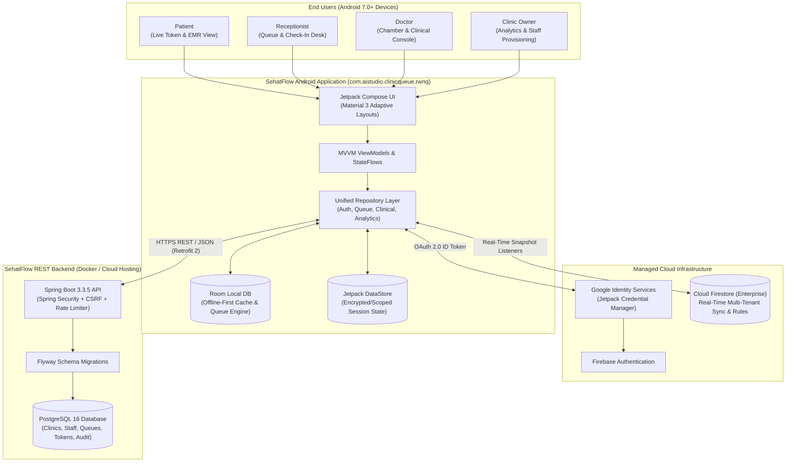
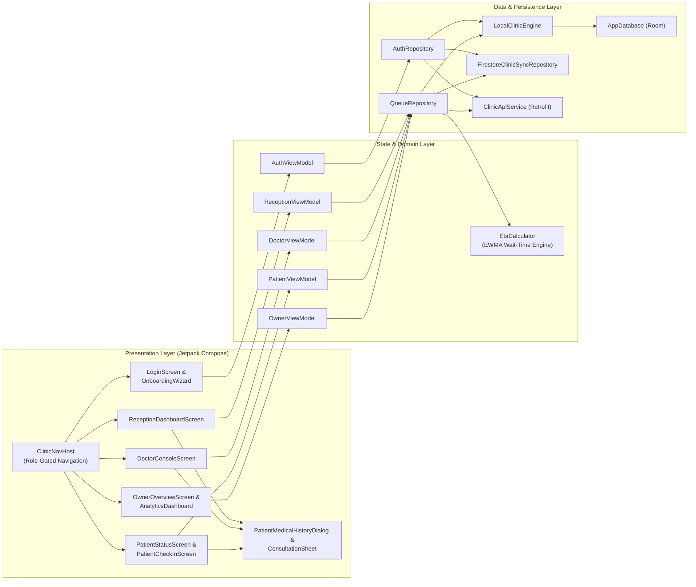
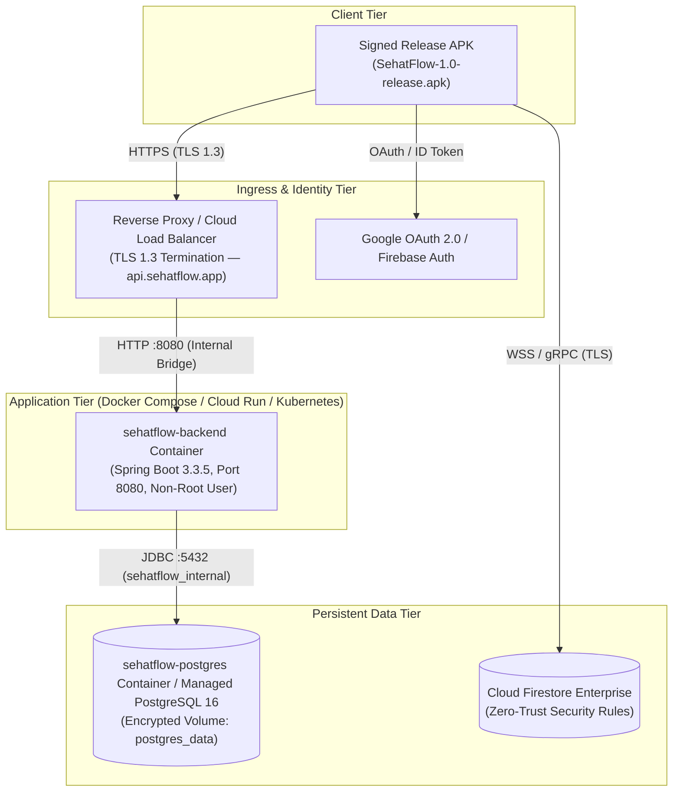

# SehatFlow — High-Level Design (HLD)

**Product Tagline:** *Less Waiting. Smarter Care.*  
**Application Name:** SehatFlow (`com.aistudio.clinicqueue.rwnq`)  
**Version:** `1.0` (`versionCode = 1`)  
**Document Status:** Production Release Architecture Specification

---

## 1. Executive Summary & System Purpose

**SehatFlow** is a multi-role, mobile-first outpatient clinic queue management, consultation workflow, and longitudinal Electronic Medical Record (EMR) platform built for high-volume clinics and outpatient departments (OPDs).

Traditional clinic waiting rooms suffer from opaque wait times, paper token confusion, congestion at reception desks, and fragmented patient visit records. SehatFlow solves these problems by providing:
1. **Zero-Confusion Live Queueing:** Real-time token issuance, priority emergency preemption (`EMERGENCY` / `SENIOR_CITIZEN`), dynamic ETA calculation, and multi-chamber routing.
2. **Role-Tailored Mobile Workspaces:** Dedicated workflows for **Patients**, **Receptionists**, **Doctors**, and **Clinic Owners / Administrators**.
3. **Longitudinal Clinical Records (EMR):** Structured SOAP notes, vital signs, diagnosis & ICD-style tagging, structured prescriptions, lab orders, and cross-visit medical history timelines.
4. **Hybrid Cloud + Edge-Resilient Architecture:** Combines real-time **Cloud Firestore** synchronization and **Google Sign-In (`CredentialManager`)** with a **Spring Boot 3.3 + PostgreSQL 16** REST backend and an offline-capable **Room SQLite** local persistence engine.

---

## 2. Target User Personas & Core Capabilities

| Persona | Authentication Method | Core Capabilities |
| :--- | :--- | :--- |
| **Patient** | Google Sign-In (`CredentialManager`) or Phone + Token Lookup | Track live token position, estimated wait time (ETA), doctor chamber status, turn-approaching alerts, clinic check-in via QR/clinic code, and longitudinal personal/family medical history. |
| **Receptionist** | Staff Credentials (`POST /api/v1/auth/login`), Google Sign-In + Staff Invite Code, or Staff PIN | Register walk-in/phone patients, issue normal/priority/emergency tokens, filter by doctor chamber, assign/reassign doctors, manage holds/skips/recalls, and inspect patient medical history. |
| **Doctor** | Staff Credentials, Google Sign-In + Staff Invite Code, or Staff PIN | Call next patient, start/complete consultations, view longitudinal patient medical history, record vitals/diagnosis/prescriptions/clinical notes, and pause/resume chamber queue. |
| **Clinic Owner / Admin** | Owner Credentials or Google Sign-In (Clinic Creator) | Onboard clinic during 14-day free trial, configure multi-doctor chambers, generate role-scoped staff invitation codes, monitor live clinic KPIs (throughput, average wait time, peak hours), and export compliance reports. |

---

## 3. System Context Diagram

---

## 4. High-Level Component Architecture

### 4.1 Android Application Tier (`/app`)
* **UI Framework:** 100% Jetpack Compose with Material Design 3 dynamic/custom medical color palettes, dark/light theme adaptation, and responsive `BoxWithConstraints` layouts for phones and clinic tablets.
* **State Management:** Unidirectional Data Flow (UDF) using Kotlin Coroutines, `StateFlow`, and `collectAsStateWithLifecycle()`.
* **Navigation & Access Control:** `ClinicNavHost` enforces strict role-based routing (`RBAC`) via `RoleGuard`. Unauthenticated or cross-role navigation attempts are intercepted and redirected to the appropriate role workspace or login screen.
* **Hybrid Sync Engine:**
  * **Primary Real-Time Cloud Sync:** `FirestoreClinicSyncRepository` synchronizes clinic metadata, active queues, tokens, and longitudinal medical records across authenticated devices in real time under zero-trust `firestore.rules`.
  * **Transactional REST Backend:** `ClinicApiService` communicates over HTTPS (`https://api.sehatflow.app/api/v1/` in release builds; `http://10.0.2.2:8090/api/v1/` in debug builds) with cookie-based `JSESSIONID` + `XSRF-TOKEN` double-submit CSRF protection.
  * **Resilient Offline Engine:** `LocalClinicEngine` backed by Room (`clinic_queue_local.db`) ensures uninterrupted clinic operations during internet brownouts, queueing mutations in `PendingSyncQueueEntity` for automatic replay when connectivity returns.

### 4.2 Backend API Tier (`/backend`)
* **Framework:** Spring Boot 3.3.5 on Java 21 (`eclipse-temurin:21-jre-alpine`).
* **Security:**
  * Stateful HTTP session cookies (`HttpOnly`, `SameSite=Strict` in prod, `Secure=true` in prod).
  * Double-submit cookie CSRF protection (`CookieCsrfTokenRepository`) for all state-mutating endpoints (`POST`, `PUT`, `PATCH`, `DELETE`).
  * Per-IP token-bucket rate limiting (`RateLimitFilter`) protecting `/api/v1/auth/login` (20 req/min in prod) and public token endpoints (90 req/min in prod).
  * Password hashing with configurable `BCryptPasswordEncoder` (strength `12` in production).
* **Database & Migrations:** PostgreSQL 16 managed by Flyway (`V1__init_schema.sql`), enforcing relational integrity, partial unique indexes for active daily queues, and an append-only `token_events` audit log.

---

## 5. Multi-Tier Deployment Topology

---

## 6. Security, Privacy & Compliance Architecture

1. **Zero-Trust Cloud Firestore Rules (`firestore.rules`):**
   * Default deny (`allow read, write: if false;`) on all paths not explicitly matched.
   * All reads and writes require `request.auth != null`.
   * Strict schema validation enforces field types, string length caps, enum constraints (`WAITING`, `CALLED`, `IN_CONSULTATION`, `COMPLETED`, `HOLD`, `CANCELLED`, `NO_SHOW`), and ownership invariants (`ownerUid == request.auth.uid`).
2. **Role-Based Access Control (RBAC):**
   * Enforced at three independent layers:
     1. **Android UI & Navigation (`RoleGuard`):** Prevents unauthorized screen access and hides privileged actions.
     2. **Spring Security (`@PreAuthorize` & `AuthPrincipal`):** Validates session role (`OWNER`, `RECEPTIONIST`, `DOCTOR`) and tenant isolation (`clinicId` match) on every REST call.
     3. **Firestore Security Rules:** Verifies authenticated user identity and document ownership before committing cloud mutations.
3. **Production Hardening:**
   * All demo banners, demo role-switching buttons, and test data generators are completely removed from the production UI.
   * `application-prod.yml` disables demo data seeding (`APP_SEED_ENABLED=false`), hides internal stack traces and exception messages (`include-message: never`, `include-stacktrace: never`), enforces `Secure` and `SameSite=Strict` cookies, and disables public Swagger UI (`APP_SWAGGER_ENABLED=false`).
   * Android release builds enforce R8 code shrinking, resource shrinking, and obfuscation (`isMinifyEnabled = true`, `isShrinkResources = true`).

---

## 7. Scalability, Reliability & Observability

* **EWMA Wait-Time Estimation (`EtaCalculator`):** Dynamically adapts estimated wait times using an Exponentially Weighted Moving Average of actual consultation durations per doctor chamber, bounded by realistic clinical floors and ceilings.
* **Idempotent Token Issuance:** Client-generated `clientRequestId` keys prevent duplicate tokens when receptionists tap "Issue Token" on unstable clinic Wi-Fi/cellular connections.
* **Health Probes:** Spring Boot Actuator exposes `/actuator/health`, `/actuator/health/liveness`, and `/actuator/health/readiness` for container orchestrator health checks and zero-downtime rolling deployments.

---

## 8. Clinic Subscription & Dual Payment Architecture

SehatFlow features a dual-modality subscription engine designed for the Indian healthcare ecosystem:

### 8.1 Dual Payment Modalities
1. **Direct Google Pay & UPI Settlement (Zero Merchant Fees, Direct-to-Bank):**
   - **Direct UPI Intent (`upi://pay`):** Launches Google Pay (`com.google.android.apps.nbu.paisa.user`), PhonePe, Paytm, or BHIM with verified parameters: `pa`, `pn`, `am`, `cu=INR`, and `tn`.
   - **Dynamic Vector QR Code:** High-contrast 29x29 vector QR rendered via Compose Canvas for desktop or companion-phone scanning.
   - **12-Digit Bank UTR Verification:** Captures automatic return intent data (`Status=SUCCESS`, `txnId`, `responseCode`) or accepts manual 12-digit UTR bank reference number with validation and idempotent activation.
   - **Privacy Isolation:** User's personal UPI ID, name, and phone number are stored strictly in gitignored `.env` and injected via `BuildConfig`, guaranteeing zero secret leaks when pushing to GitHub.
2. **Server-Side Verified Payment Gateway (Razorpay):**
   - **Zero Secrets in APK:** `RAZORPAY_KEY_ID`, `RAZORPAY_KEY_SECRET`, and `RAZORPAY_WEBHOOK_SECRET` reside exclusively on the Spring Boot backend (`application-prod.yml` / `.env`).
   - **Cryptographic HMAC-SHA256 Verification:** `POST /api/v1/subscriptions/verify` computes constant-time HMAC-SHA256 over `orderId + "|" + paymentId`. Subscriptions are never activated on client state alone.
   - **Signed Webhooks:** `POST /api/v1/webhooks/razorpay` verifies `X-Razorpay-Signature` and handles lifecycle events: `payment.captured`, `subscription.charged`, `payment.failed`, and `refund.processed` (which immediately revokes the clinic's entitlement).
   - **Early Renewal Stacking:** When an active plan is renewed before expiration, the new duration is stacked onto the existing period (`currentExpiresAt + plan.durationDays`).
   - **Zero PCI Card Storage:** Raw card numbers (PAN) and CVVs are strictly rejected; only masked instruments (`Card •••• 4242`, UPI VPA) are stored.

### 8.2 PostgreSQL Flyway Schema Migrations
- `V1__init_schema.sql`: Core clinic, staff, doctor chamber, queue session, token, and audit log tables.
- `V2__subscriptions_and_app_updates.sql`: `clinic_subscriptions`, `payment_transactions`, `payment_webhook_events`, and `app_releases`.

---

## 9. Cryptographic In-App Update Engine (`AppUpdateManager`)

For clinics and doctor tablets deployed outside the Google Play Store or receiving direct enterprise releases:
1. **Trusted HTTPS Manifest:** Queries `GET /api/v1/releases/latest` (served by `SubscriptionAndUpdateController` backed by `release/version-manifest.json`).
2. **Untrusted Domain Rejection:** Validates release URL against trusted domains; blocks cleartext HTTP.
3. **Mandatory vs. Optional Logic:** Evaluates `installedVersionCode` against `latestVersionCode` and `minRequiredVersionCode`.
4. **Pre-Install Cryptographic & Signature Verification:**
   - Computes SHA-256 digest of the downloaded APK and verifies against `manifest.sha256Checksum` (deletes corrupt downloads on mismatch).
   - Verifies APK signature scheme v2 certificate compatibility against `signingCertSha256 = e7a6c74f3503b88d43919eb8a763da4692e281c01f79b07da0a30939f4d5e5fd`.
   - Preserves local Room databases, active sessions, and DPDP preferences across in-place upgrades.
   - Launches Android Package Installer securely via `FileProvider` (`content://com.aistudio.clinicqueue.rwnq.fileprovider/`).
