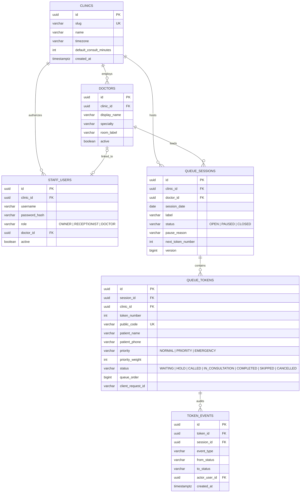
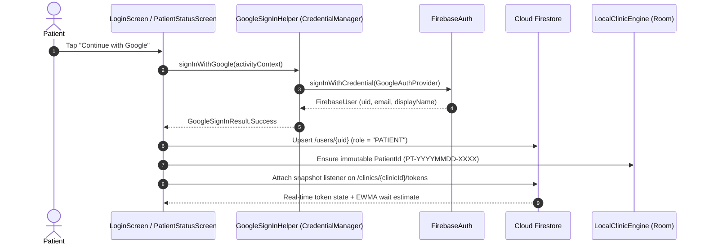
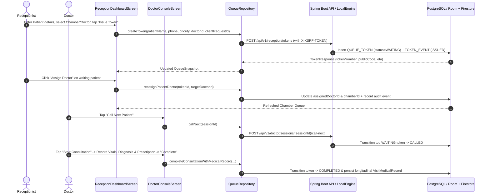
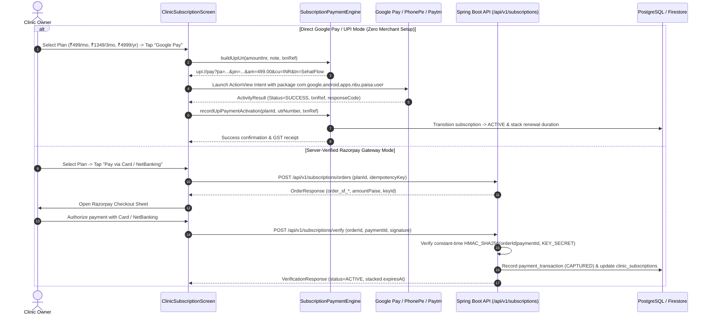
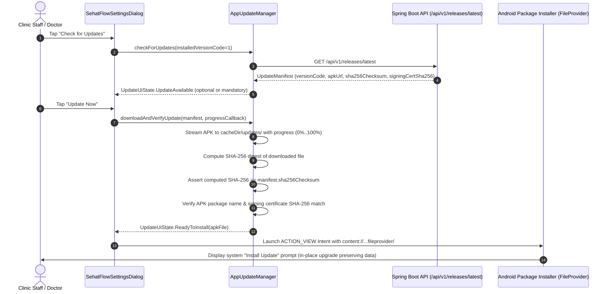

# SehatFlow — Low-Level Design (LLD)

**Application Package ID:** `com.aistudio.clinicqueue.rwnq`  
**Android Namespace:** `com.example`  
**Backend Group / Artifact:** `com.clinicqueue:clinic-queue-backend:0.1.0`  
**Version:** `1.0` (`versionCode = 1`)

---

## 1. Repository & Module Structure

```text
/
├── app/                                      # Android Client Application (Kotlin + Jetpack Compose)
│   ├── build.gradle.kts                      # Android build config, R8 release shrinking, signing configs
│   ├── google-services.json                  # Firebase project configuration (gen-lang-client-0880099874)
│   ├── proguard-rules.pro                    # R8/ProGuard keep rules for Retrofit, Moshi, Room, Firestore
│   └── src/
│       ├── main/
│       │   ├── AndroidManifest.xml           # Permissions, MainActivity, FileProvider, adaptive launcher icons
│       │   ├── java/com/example/
│       │   │   ├── MainActivity.kt           # Edge-to-edge Activity host & theme state observer
│       │   │   ├── ClinicApplication.kt      # Application singleton & AppContainer DI graph
│       │   │   ├── core/
│       │   │   │   ├── common/               # Constants, RoleGuard, EtaCalculator, AppContainer
│       │   │   │   ├── payment/              # SubscriptionPaymentEngine (Direct UPI, QR, UTR, Razorpay)
│       │   │   │   └── update/               # AppUpdateManager (HTTPS manifest, SHA-256 digest, APK cert check)
│       │   │   ├── data/
│       │   │   │   ├── auth/                 # GoogleSignInHelper (Jetpack Credential Manager)
│       │   │   │   ├── firestore/            # FirestoreClinicSyncRepository (Real-time cloud sync)
│       │   │   │   ├── local/                # Room AppDatabase, Entities, DAOs, LocalClinicEngine, DataStore
│       │   │   │   ├── model/                # Domain models, Moshi DTOs, EMR/Consultation models
│       │   │   │   ├── remote/               # ClinicApiService (Retrofit), DynamicBaseUrlInterceptor, CookieJar
│       │   │   │   └── repository/           # AuthRepository, QueueRepository, ConsultationHistoryRepository
│       │   │   └── ui/
│       │   │       ├── auth/                 # LoginScreen, AuthViewModel
│       │   │       ├── common/               # SehatFlowSettingsAndHealthDialogs, Shared UI
│       │   │       ├── doctor/               # DoctorDashboardScreen, DoctorViewModel, ConsultationSheet
│       │   │       ├── medical/              # PatientMedicalHistoryDialog, ClinicalTimelineComponents
│       │   │       ├── navigation/           # AppNavHost, NavRoute
│       │   │       ├── owner/                # ClinicAdminDashboardScreen, OwnerViewModel, OnboardingWizard
│       │   │       ├── patient/              # ClinicSelectScreen, PatientLiveQueueScreen, VisitHistoryScreen
│       │   │       ├── receptionist/         # ReceptionDashboardScreen, ReceptionViewModel
│       │   │       ├── subscription/         # ClinicSubscriptionScreen (Direct UPI, GPay, QR, UTR, Plans)
│       │   │       └── theme/                # Theme.kt, Color.kt, Type.kt
│       │   └── res/                          # Vector drawables, adaptive icons, strings.xml, backup rules
│       └── test/java/com/example/            # 66 JUnit 4 + Robolectric UAT, Subscription, Update, Security tests
├── backend/                                  # Spring Boot 3.3.5 REST API (Java 21 + PostgreSQL 16 + Flyway)
│   ├── Dockerfile                            # Multi-stage Maven + Eclipse Temurin 21 JRE Alpine container
│   ├── pom.xml                               # Maven dependencies (Web, Security, Data JPA, Flyway, Actuator)
│   └── src/main/
│       ├── java/com/clinicqueue/
│       │   ├── ClinicQueueApplication.java   # Spring Boot entrypoint
│       │   ├── common/                       # ApiException, ErrorCode, GlobalExceptionHandler
│       │   ├── config/                       # SecurityConfig, RateLimitFilter, CsrfCookieFilter, SeedDataRunner
│       │   ├── controller/                   # AuthController, ReceptionQueueController, DoctorSessionController,
│       │   │                                 # PublicTokenController, OwnerController
│       │   ├── subscription/                 # SubscriptionAndUpdateController (Razorpay verify, webhooks, releases)
│       │   ├── domain/                       # JPA Entities (Clinic, StaffUser, Doctor, QueueSession, QueueToken, TokenEvent)
│       │   ├── dto/                          # Request/Response Records with Jakarta Validation
│       │   ├── repository/                   # Spring Data JPA Repositories
│       │   └── service/                      # QueueService, AuthService, EtaService, OwnerAnalyticsService
│       └── resources/
│           ├── application.yml               # Default/development configuration
│           ├── application-prod.yml          # Hardened production profile configuration
│           └── db/migration/
│               ├── V1__init_schema.sql       # Flyway relational schema & partial indexes
│               └── V2__subscriptions_and_app_updates.sql # Subscriptions, payments, webhooks & releases
├── release/
│   ├── SehatFlow-1.0-release.apk             # Signed, R8-minified public release APK
│   └── version-manifest.json                 # Cryptographic update manifest (SHA-256, cert hash, size)
├── .github/workflows/ci.yml                  # Automated GitHub Actions CI pipeline
├── docker-compose.yml                        # Production multi-container orchestration (PostgreSQL 16 + Backend)
├── firestore.rules                           # Zero-trust Cloud Firestore security rules
├── firebase-blueprint.json                   # Firestore schema blueprint
├── HLD.md                                    # High-Level Design specification
├── LLD.md                                    # Low-Level Design specification
└── README.md                                 # Project README & User Handover Guide
```

---

## 2. Android Client Low-Level Design

### 2.1 Dependency Injection (`AppContainer`)
`AppContainer` (initialized in `ClinicApplication`) provides constructor-injected singletons across the app:
* `sessionPreferences: SessionPreferences` — Jetpack DataStore (`clinic_session_prefs`) storing active session role, `clinicId`, `actorId`, theme mode (`SYSTEM`, `LIGHT`, `DARK`), DPDP consent state, and optional unverified patient self-reported health profile.
* `appDatabase: AppDatabase` — Room SQLite database (`clinic_queue_local.db`, schema version `3`) providing `ClinicQueueDao` for offline-capable persistence and pending mutation queueing.
* `apiService: ClinicApiService` — Retrofit 2 interface backed by `OkHttpClient` with:
  * `PersistentSessionCookieJar` (`JSESSIONID` + `XSRF-TOKEN` double-submit CSRF header injection).
  * `DynamicBaseUrlInterceptor` (enforcing HTTPS for non-loopback hosts; defaults to `Constants.PRODUCTION_BASE_URL = "https://api.sehatflow.app/api/v1/"` in release builds and `http://10.0.2.2:8090/api/v1/` in debug emulator builds).
* `firestoreSyncRepository: FirestoreClinicSyncRepository` — Real-time Cloud Firestore repository syncing `/users/{uid}`, `/clinics/{clinicId}`, `/clinics/{clinicId}/tokens/{tokenId}`, and `/subscriptions/{subId}`.
* `authRepository: AuthRepository` & `queueRepository: QueueRepository` — Unified repositories coordinating REST, Firestore, and local Room storage.

### 2.2 Navigation Routes & RBAC (`NavRoutes` & `RoleGuard`)

| Route Constant | Destination Screen | Permitted Roles (`RoleGuard`) | Purpose |
| :--- | :--- | :--- | :--- |
| `NavRoutes.LOGIN` (`"login"`) | `LoginScreen` | Public / Unauthenticated | Unified welcome page: Patient Google Sign-In, Token Status lookup, Clinic Admin 14-day trial onboarding, Staff Invitation Code verification, and Staff Credential login. |
| `NavRoutes.PATIENT_STATUS` (`"patient_status/{tokenCode}"`) | `PatientStatusScreen` | `PATIENT` (or Token Holder) | Live token status card, EWMA wait-time countdown, chamber indicator, prescription upload, doctor discovery, and longitudinal medical history dialog. |
| `NavRoutes.RECEPTION_DASHBOARD` (`"reception_dashboard"`) | `ReceptionDashboardScreen` | `RECEPTIONIST`, `OWNER` | Walk-in token registration, priority/emergency queue management, chamber filtering, interactive doctor assignment/reassignment dialog, and demographic/visit medical history view. |
| `NavRoutes.DOCTOR_CONSOLE` (`"doctor_console"`) | `DoctorConsoleScreen` | `DOCTOR`, `OWNER` | Active consultation workspace, Call Next / Start / Complete / Hold / No-Show controls, full SOAP & prescription composer, and longitudinal clinical timeline (`PatientMedicalHistoryDialog`). |
| `NavRoutes.OWNER_OVERVIEW` (`"owner_overview"`) | `OwnerOverviewScreen` | `OWNER` | Multi-chamber throughput metrics, average wait-time analytics, doctor schedule matrix, staff invitation code generator (`SF-DOC-*`, `SF-REC-*`), and Indian clinical record compliance tracker. |

### 2.3 Longitudinal EMR & Role-Scoped Redaction
`LocalClinicEngine` and `PatientMedicalHistoryDialog` enforce strict clinical privacy boundaries in accordance with the **Digital Personal Data Protection Act (DPDP) 2023** and Indian clinical establishment standards:
* **Immutable Patient Identifier (`patientId`):** Generated in the unambiguous format `PT-YYYYMMDD-XXXX` (excluding visually ambiguous characters `I`, `O`, `0`, `1`).
* **Doctor View (`DOCTOR`):** Full access to longitudinal SOAP clinical notes, presenting complaints, vitals (`BP`, `SpO2`, `Pulse`, `Temp`, `Weight`), diagnoses, prescriptions, lab orders, and versioned clinical addenda (`ClinicalAddendum`).
* **Receptionist & Owner View (`RECEPTIONIST`, `OWNER`):** Restricted to administrative visit metadata, token timestamps, assigned doctor/chamber, and billing/record-request tracking. Clinical notes and diagnoses are redacted at the repository layer before reaching the UI.
* **Patient View (`PATIENT`):** Read-only access strictly isolated to the authenticated patient's own consultations (`patientId` ownership check) plus structured prescription summaries.

---

## 3. Backend API Specification (`/api/v1`)

### 3.1 Authentication & Session Endpoints (`AuthController`)
| Method | Path | Auth | Request Body | Response DTO | Description |
| :--- | :--- | :--- | :--- | :--- | :--- |
| `POST` | `/api/v1/auth/login` | Public (Rate-Limited) | `LoginRequest { clinicSlug, username, password }` | `StaffProfileResponse` | Authenticates staff via BCrypt, rotates HTTP session (`JSESSIONID`), and issues `XSRF-TOKEN` cookie. |
| `POST` | `/api/v1/auth/logout` | Authenticated | None | `204 No Content` | Invalidates active HTTP session and clears session cookie. |
| `GET` | `/api/v1/auth/me` | Authenticated | None | `StaffProfileResponse` | Returns currently authenticated staff principal (`userId`, `clinicId`, `role`, `doctorId`, `displayName`). |

### 3.2 Receptionist Queue Endpoints (`ReceptionQueueController`)
| Method | Path | Auth Role | Description |
| :--- | :--- | :--- | :--- |
| `GET` | `/api/v1/reception/queue/current` | `RECEPTIONIST`, `DOCTOR`, `OWNER` | Returns active `QueueSnapshotResponse` including waiting tokens, active consultation, and chamber summary metrics. |
| `POST` | `/api/v1/reception/queue/sessions` | `RECEPTIONIST`, `OWNER` | Opens a new daily `QueueSession` for a specific `doctorId` (`OPEN` status). |
| `POST` | `/api/v1/reception/tokens` | `RECEPTIONIST`, `OWNER` | Issues a new `QueueToken` (`NORMAL`, `PRIORITY`, or `EMERGENCY`) with idempotency via `clientRequestId`. |
| `POST` | `/api/v1/reception/tokens/{tokenId}/priority` | `RECEPTIONIST`, `OWNER` | Escalates or adjusts token priority and records audit reason in `token_events`. |
| `POST` | `/api/v1/reception/tokens/{tokenId}/hold` | `RECEPTIONIST`, `OWNER` | Places a `WAITING` token on `HOLD` (e.g., patient stepped out for diagnostics). |
| `POST` | `/api/v1/reception/tokens/{tokenId}/unhold` | `RECEPTIONIST`, `OWNER` | Restores a `HOLD` token back to `WAITING` in priority order. |
| `POST` | `/api/v1/reception/tokens/{tokenId}/cancel` | `RECEPTIONIST`, `OWNER` | Cancels a token (`CANCELLED`) and frees daily session capacity. |
| `POST` | `/api/v1/reception/tokens/{tokenId}/requeue` | `RECEPTIONIST`, `OWNER` | Re-queues a `SKIPPED` or `NO_SHOW` token back into the active waiting list. |

### 3.3 Doctor Session Endpoints (`DoctorSessionController`)
| Method | Path | Auth Role | Description |
| :--- | :--- | :--- | :--- |
| `POST` | `/api/v1/doctor/sessions/{sessionId}/call-next` | `DOCTOR`, `RECEPTIONIST`, `OWNER` | Selects highest-priority `WAITING` token (`priority_weight DESC, queue_order ASC`) and transitions it to `CALLED`. |
| `POST` | `/api/v1/doctor/tokens/{tokenId}/start` | `DOCTOR`, `OWNER` | Transitions `CALLED` token to `IN_CONSULTATION` and stamps `consultation_started_at`. |
| `POST` | `/api/v1/doctor/tokens/{tokenId}/complete` | `DOCTOR`, `OWNER` | Marks consultation `COMPLETED`, stamps `consultation_ended_at`, and updates rolling EWMA consultation duration. |
| `POST` | `/api/v1/doctor/tokens/{tokenId}/skip` | `DOCTOR`, `RECEPTIONIST`, `OWNER` | Marks a `CALLED` token as `SKIPPED` if the patient does not respond at the chamber door. |
| `POST` | `/api/v1/doctor/sessions/{sessionId}/pause` | `DOCTOR`, `RECEPTIONIST`, `OWNER` | Pauses chamber session (`PAUSED`) with a visible reason (e.g., emergency round) and suppresses ETA countdowns. |
| `POST` | `/api/v1/doctor/sessions/{sessionId}/resume` | `DOCTOR`, `RECEPTIONIST`, `OWNER` | Resumes `PAUSED` session back to `OPEN`. |
| `POST` | `/api/v1/doctor/sessions/{sessionId}/close` | `DOCTOR`, `RECEPTIONIST`, `OWNER` | Closes daily session (`CLOSED`) once consultations conclude. |

### 3.4 Public Patient Token & Owner Overview Endpoints
| Method | Path | Auth Role | Description |
| :--- | :--- | :--- | :--- |
| `GET` | `/api/v1/public/tokens/{publicCode}` | Public (Rate-Limited) | Returns privacy-safe `PublicTokenStatusResponse` (masked name, token number, people ahead, EWMA wait range, chamber state). |
| `GET` | `/api/v1/owner/overview` | `OWNER` | Returns clinic-wide daily operational KPIs (`completedCount`, `waitingCount`, `averageWaitMinutes`, `averageConsultationMinutes`). |

---

## 4. Database Schemas

### 4.1 PostgreSQL Relational Schema (`backend/src/main/resources/db/migration/V1__init_schema.sql`)



### 4.2 Cloud Firestore Document Schema (`firebase-blueprint.json` & `firestore.rules`)
* `/users/{userId}` — Authenticated user profile (`uid`, `email`, `displayName`, `role`, `clinicId`, `phone`, `createdAt`).
* `/clinics/{clinicId}` — Clinic configuration (`clinicId`, `name`, `ownerUid`, `address`, `phone`, `specialization`, `dailyTokenCapacity`, `subscriptionStatus`, `trialEndsAt`).
* `/clinics/{clinicId}/tokens/{tokenId}` — Live synchronized queue token (`tokenId`, `tokenNumber`, `clinicId`, `patientUid`, `patientName`, `doctorId`, `status`, `priority`, `estimatedWaitMinutes`, `createdAt`).
* `/subscriptions/{subscriptionId}` — Clinic SaaS subscription & trial ledger (`subscriptionId`, `clinicId`, `ownerUid`, `planName`, `amountInr`, `status`, `validUntil`).

---

## 5. Key Sequence Diagrams

### 5.1 Patient Google Sign-In & Real-Time Token Synchronization



### 5.2 Receptionist Token Issuance, Doctor Assignment & Consultation Lifecycle



### 5.3 Dual-Modality Subscription Flow (Direct UPI / GPay & Razorpay PG)



### 5.4 Cryptographic In-App Update Verification Sequence



