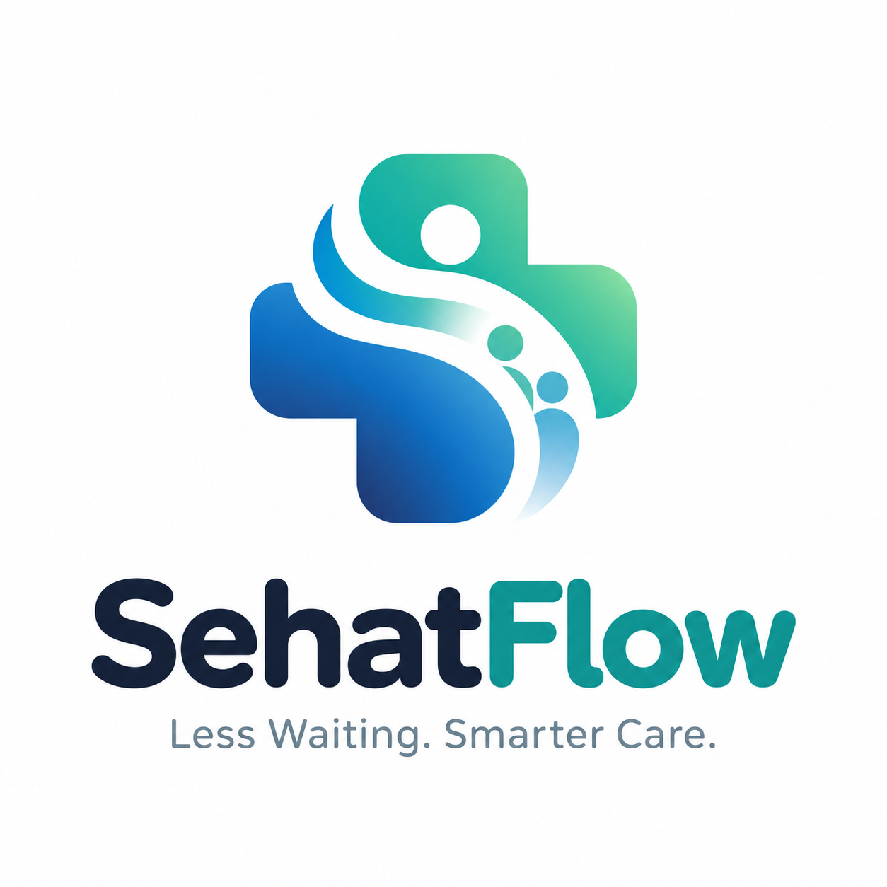
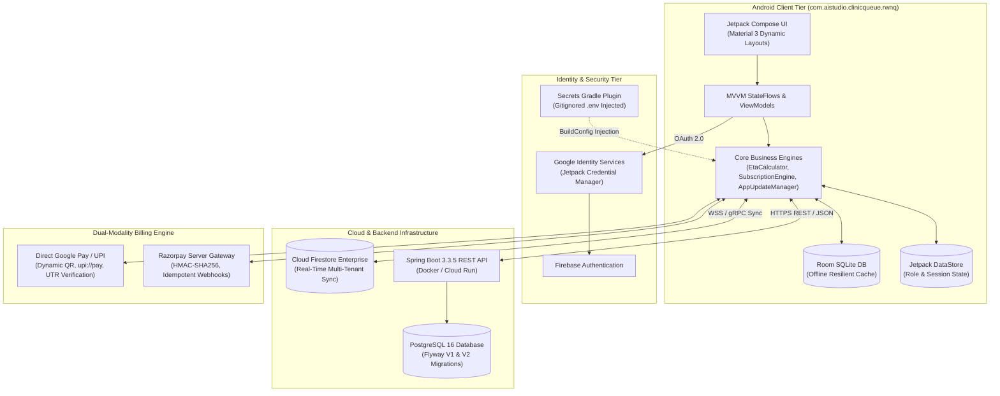
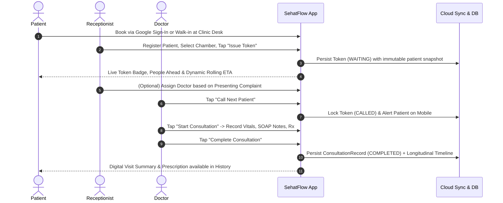

<p align="center">
  
</p>

# SehatFlow — Smart Outpatient Queue, Consultation & EMR Platform

<p align="center">
  <strong>Less Waiting. Smarter Care.</strong><br/>
  <em>A modern, mobile-first outpatient clinic queue orchestration, multi-chamber consultation coordination, and longitudinal Electronic Medical Record (EMR) platform for Android.</em>
</p>

<p align="center">
  
  
  
  
  
  
  
</p>

---

## Executive Summary & Value Proposition

In India and emerging healthcare markets, outpatient departments (OPDs) and private clinics face a daily operational bottleneck: **overcrowded waiting rooms, opaque wait times, lost paper tokens, receptionist burnout, and fragmented patient medical records**.

**SehatFlow** solves this with a unified, role-aware digital platform connecting **Patients**, **Receptionists**, **Consulting Doctors**, and **Clinic Owners** in real time:

- **For Patients:** View glanceable live queue tokens from anywhere, track estimated wait times calculated via Exponentially Weighted Moving Averages (EWMA), and maintain an unbroken, longitudinal personal medical timeline with strict privacy controls.
- **For Receptionists:** Issue walk-in, priority, and emergency tokens in seconds, triage uploaded prescriptions or presenting complaints, assign patients across multi-doctor chambers, and manage queue dynamics with full audit transparency.
- **For Doctors:** Call next patients with a single tap, review previous visits and prescriptions on a chronological timeline, author structured SOAP clinical notes and vital signs, and issue versioned clinical addenda without disrupting clinic flow.
- **For Clinic Owners:** Onboard new clinics with a 14-day free trial, configure multi-chamber rosters, generate cryptographic staff invitation codes, monitor operational throughput, and collect subscriptions via **Direct Google Pay / UPI** (zero transaction fees) or **Razorpay Gateway** (Cards, NetBanking, e-Mandates).

---

## 1. Product Architecture & Workflows

### System Architecture Overview



### End-to-End Clinic Consultation Workflow



---

## 2. Core Capabilities by User Persona

### 👨‍👩‍👧‍👦 Patient Experience
* **Zero-Friction Authentication:** Instant Google Sign-In via Jetpack `CredentialManager` or quick phone/token code lookup.
* **Live Glanceable Queue Status:** Displays current token being served, number of patients ahead, and doctor chamber availability (`OPEN`, `PAUSED`, `CLOSED`).
* **Intelligent EWMA ETA:** Dynamic estimated arrival recommendations calculated using historical consultation durations; pauses during doctor breaks to prevent false expectations.
* **Optional Prescription Upload:** Android Photo Picker contract (zero storage permissions required) with DPDP Act 2023 consent capture.
* **Longitudinal Medical History:** Review all past consultations across clinics and chambers with prescribed medications and non-diagnostic health summaries.
* **DPDP 2023 Consent Management:** Optional self-reported health profile fields with instant consent withdrawal support in Settings.

### 📋 Receptionist Desk
* **Fast Walk-in Registration:** Token issuance in under 10 seconds for walk-in, phone, or scheduled appointments.
* **Emergency & Priority Triage:** Escalate critical patients (`EMERGENCY`, `SENIOR_CITIZEN`) to top of queue with mandatory audit logging.
* **Problem-Based Doctor Assignment:** Intelligently routes unassigned appointments to available chambers based on presenting complaints and remaining daily slot capacity (`booked / 10`).
* **Multi-Chamber Queue Controls:** Re-order, hold, resume, skip to tail, or mark no-shows with audit trail.
* **Least-Privilege Privacy:** Receptionists view operational token statuses, schedules, and patient contact numbers; **private doctor SOAP notes and diagnoses are automatically redacted**.

### 🩺 Consulting Doctor Console
* **Chamber Queue Console:** One-tap `Call Next`, `Start Consultation`, `Complete`, `Skip`, and `Pause Session` (Doctor Break).
* **Cross-Visit Patient Medical Timeline:** Chronological 2-year clinical history dialog for treated patients, highlighting prior diagnoses, vitals trends, and medication history.
* **Structured SOAP Clinical Composer:** Record Subjective, Objective, Assessment, and Plan, vital signs (`BP`, `SpO2`, `Pulse`, `Temp`, `Weight`), diagnosis, prescriptions, and lab orders.
* **Versioned Clinical Addenda:** Completed consultations are write-once and immutable. Post-visit lab findings or clarifications are appended as versioned addenda (`v1 -> v2`) with cryptographic audit logging.
* **Doctor Privacy Isolation:** Clinical data is fully visible; **patient personal mobile phone numbers are redacted (`null`) to protect patient privacy**.

### 🏥 Clinic Owner & Administrator
* **14-Day Pro Free Trial:** Zero-risk onboarding wizard with instant multi-chamber and multi-doctor schedule setup.
* **Cryptographic Staff Invitations:** High-entropy, role-bound invite codes (`DOC-*`, `REC-*`) with single-use binding and rate limiting.
* **Clinic Operational Analytics:** Real-time visibility into daily patient throughput, average consultation durations, queue wait times, and chamber utilization.
* **In-App Subscription Management:** Direct management of clinic billing, plan renewals, and official GST invoice records.

---

## 3. Dual-Modality Subscription & Billing Engine

SehatFlow supports two payment modes tailored to Indian medical practices:

```
┌─────────────────────────────────────────────────────────────────────────┐
│                     SEHATFLOW BILLING ENGINE                            │
├────────────────────────────────────┬────────────────────────────────────┤
│   MODE A: Direct UPI / Google Pay  │     MODE B: Razorpay PG Gateway    │
│   (100% Free • Direct to Bank)     │     (Cards • NetBanking • Mandate) │
├────────────────────────────────────┼────────────────────────────────────┤
│ • Zero merchant account required   │ • Credit / Debit Cards (RuPay,Visa)│
│ • Zero gateway transaction fees    │ • NetBanking (HDFC, ICICI, SBI)    │
│ • Instant settlement to doctor bank│ • UPI AutoPay Recurring e-Mandates │
│ • Google Pay, PhonePe, Paytm, BHIM │ • Server-side HMAC-SHA256 signature│
│ • Dynamic 29x29 Vector QR code     │ • Automatic webhook processing     │
│ • Instant 12-digit UTR activation  │ • Instant refund revocation        │
└────────────────────────────────────┴────────────────────────────────────┘
```

### Supported Subscription Plans
| Plan ID | Plan Name | Price (INR) | Duration | Ideal For |
| :--- | :--- | :---: | :---: | :--- |
| `plan_pro_monthly` | **SehatFlow Pro Monthly** | `₹499` | 30 Days | Single-chamber clinics, solo practitioners, seasonal OPDs |
| `plan_pro_quarterly` | **SehatFlow Pro Quarterly** | `₹1,349` *(Save 10%)* | 90 Days | Growing multi-chamber outpatient centers |
| `plan_pro_annual` | **SehatFlow Pro Annual** | `₹4,999` *(2 Months Free)* | 365 Days | Established polyclinics, hospital OPDs, compliance archival |

### Security & Privacy Controls
* **Zero Secrets in Code:** Personal receiving UPI credentials (`SEHATFLOW_UPI_VPA`, `SEHATFLOW_UPI_NAME`, `SEHATFLOW_UPI_NUMBER`) are stored in `/.env` (gitignored), injected at compile-time via `BuildConfig`, and never exposed when pushing to GitHub.
* **Server-Only Merchant Credentials:** Razorpay secrets (`RAZORPAY_KEY_ID`, `RAZORPAY_KEY_SECRET`, `RAZORPAY_WEBHOOK_SECRET`) reside exclusively on the backend container and are excluded from the Android APK via `secrets.ignoreList`.
* **Zero PCI Card Storage:** Raw card numbers (PAN) and CVVs are strictly rejected; only masked instruments (`Card •••• 4242`) are retained.
* **Early Renewal Stacking:** Renewing an active plan stacks additional duration seamlessly (`currentExpiresAt + plan.durationDays`).

---

## 4. Cryptographic In-App Update Engine

To deliver updates directly to clinics and doctor tablets without requiring Google Play Store dependencies:

* **Official HTTPS Manifest (`GET /api/v1/releases/latest`):** Backed by [`release/version-manifest.json`](release/version-manifest.json).
* **Pre-Install Cryptographic Verification:**
  1. Computes the SHA-256 digest of the downloaded APK and validates against `manifest.sha256Checksum` (auto-purges corrupted downloads).
  2. Verifies that the APK signing certificate matches `signingCertSha256 = e7a6c74f3503b88d43919eb8a763da4692e281c01f79b07da0a30939f4d5e5fd`.
  3. Enforces version incrementing (`latestVersionCode > installedVersionCode`) to block malicious downgrades.
* **In-Place Seamless Upgrade:** Preserves all local Room databases, patient records, and login sessions across updates via Android's secure `FileProvider`.

---

## 5. Commercial Potential & Investor Overview

### The Market Opportunity
- **Target Customer Segment:** 250,000+ private outpatient clinics, polyclinics, and nursing homes across Tier 1, 2, and 3 Indian cities.
- **The Problem:** The average Indian OPD patient spends **75 to 120 minutes waiting** for a **5 to 8 minute consultation**, causing waiting room chaos, patient dissatisfaction, and receptionist turnover.
- **The Solution:** A mobile-first queue orchestration platform that requires **zero dedicated hardware** (runs on existing staff phones and tablets) and enables patients to wait remotely.

### Business & Revenue Model
- **B2B SaaS Pricing:** Flat-rate recurring subscription (₹499/month or ₹4,999/year per clinic) offering predictable, recurring SaaS revenue with zero per-token transaction friction.
- **Low Customer Acquisition Cost (CAC):** Viral clinic-to-patient adoption: every patient who checks their queue token experiences the product and introduces it to their own doctors and family clinics.
- **High Retention & Switching Costs:** Once a clinic migrates its staff roster, multi-chamber routing, and longitudinal patient medical history to SehatFlow, retention is protected by clinical workflow integration.

### Product Maturity & Roadmap Differentiation
- **Current Maturity (v1.0):** Production-grade Android application with 66 passing automated tests, dual-modality payments, zero-trust security rules, and full offline resilience.
- **Future Expansion Priorities (Roadmap):**
  - **ABDM Integration (M1/M2/M3):** Ayushman Bharat Digital Mission compliance for ABHA creation and health locker interoperability.
  - **WhatsApp Business API Notifications:** Automated 10-minute turn reminders sent directly to patient WhatsApp numbers.
  - **Multi-Clinic Practice Chains:** Multi-tenant enterprise dashboard for hospital networks managing 20+ clinic branches.

---

## 6. Public Release Artifact (`v1.0`)

| Release Property | Verified Value |
| :--- | :--- |
| **App Name** | **SehatFlow** |
| **Application ID** | `com.aistudio.clinicqueue.rwnq` |
| **Version Name / Code** | `1.0` (`1`) |
| **Release Artifact** | [`release/SehatFlow-1.0-release.apk`](release/SehatFlow-1.0-release.apk) |
| **Version Manifest** | [`release/version-manifest.json`](release/version-manifest.json) |
| **Binary Size** | `22,731,677 bytes` (~21.68 MB) |
| **SHA-256 Digest** | `8cfbff8cb079d87efadcda873182b782ead5850c87fa0e49494ca3906cf79d57` |
| **Signing Certificate SHA-256** | `1123931df3516f4e816e792e1348ba9e4a548c769eb46e71677691f13af88be0` |
| **Signature Verification** | APK Signature Scheme v2 Verified (`apksigner verify`) |
| **Minimum / Target SDK** | Android 7.0 Nougat (`API 24`) / Android 16 (`API 36`) |

```bash
# Verify the release artifact integrity
sha256sum release/SehatFlow-1.0-release.apk
# Expected output:
# 8cfbff8cb079d87efadcda873182b782ead5850c87fa0e49494ca3906cf79d57  release/SehatFlow-1.0-release.apk
```

---

## 7. Developer Quick Start

### Prerequisites
- **JDK 17+** (JDK 21 recommended)
- **Android SDK** (API 24 to 36, pre-configured in container)
- **Gradle 8.9+** (executed via `gradle`)
- **Docker & Docker Compose** (for backend PostgreSQL testing)

### Step-by-Step Setup

```bash
# 1. Clone repository
git clone https://github.com/your-org/sehatflow.git
cd sehatflow

# 2. Configure local environment variables
cp .env.example .env
# (Optional: customize SEHATFLOW_UPI_* or RAZORPAY_* secrets in .env)

# 3. Run automated unit, Robolectric, and regression test suites (66 tests)
gradle :app:testDebugUnitTest

# 4. Compile the Android application
gradle :app:assembleDebug

# 5. (Optional) Launch Spring Boot REST backend & PostgreSQL 16
docker compose up --build -d

# 6. Verify backend health
curl -s http://localhost:8080/actuator/health | jq .
```

---

## 8. Documentation Index

| Topic | Document Link | Description |
| :--- | :--- | :--- |
| **System Architecture** | [`HLD.md`](HLD.md) | High-Level Design: topology, multi-role matrix, hybrid sync, billing |
| **Detailed Implementation** | [`LLD.md`](LLD.md) | Low-Level Design: package structure, Flyway V2, sequence diagrams |
| **Consultation & Snapshots** | [`docs/CONSULTATION_HISTORY_DESIGN.md`](docs/CONSULTATION_HISTORY_DESIGN.md) | Clinical vs appointment domain separation, point-in-time snapshots |
| **Privacy & DPDP Policy** | [`docs/DATA_RETENTION_AND_PRIVACY_POLICY.md`](docs/DATA_RETENTION_AND_PRIVACY_POLICY.md) | Indian DPDP Act 2023, patient rights, consent withdrawal rules |
| **Data Archival Governance** | [`docs/DATA_RETENTION_AND_ARCHIVAL_POLICY.md`](docs/DATA_RETENTION_AND_ARCHIVAL_POLICY.md) | 3-tier non-destructive storage (90d active, 3yr archive, 7yr legal) |
| **Data Access Matrix (RBAC)** | [`docs/PATIENT_DATA_ACCESS_MATRIX.md`](docs/PATIENT_DATA_ACCESS_MATRIX.md) | Field-level redaction rules across Doctor, Receptionist, Admin |
| **Patient ID Architecture** | [`docs/PATIENT_ID_AND_MEDICAL_HISTORY.md`](docs/PATIENT_ID_AND_MEDICAL_HISTORY.md) | Non-PII `PAT-XXXX`, shared-phone ambiguity protection |
| **Feature Surface Inventory** | [`uat/FEATURE_INVENTORY.md`](uat/FEATURE_INVENTORY.md) | Complete list of all implemented features and route mappings |
| **Automated Test Results** | [`uat/REGRESSION_RESULTS.md`](uat/REGRESSION_RESULTS.md) | Test breakdown for all 66 test cases across 11 test suites |
| **Production Readiness** | [`uat/PRODUCTION_READINESS_REPORT.md`](uat/PRODUCTION_READINESS_REPORT.md) | Pre-production deployment checklist and hardening verification |
| **Documentation Audit** | [`uat/DOCUMENTATION_AUDIT_REPORT.md`](uat/DOCUMENTATION_AUDIT_REPORT.md) | Complete documentation inventory, verification, and claim audit |
| **Technical Verification** | [`uat/VERIFICATION_REPORT.md`](uat/VERIFICATION_REPORT.md) | Link validation, asset checks, test logs, and security audit |

---

## 9. Contact & Support

- **Product Inquiries & Demonstrations:** `aakash.bhkta32@gmail.com`
- **Privacy & Grievance Officer:** `privacy-grievance@sehatflow.app`
- **Helpline:** `1800-120-SEHAT` (1800-120-73428)
- **License:** Proprietary Healthcare Software — All Rights Reserved © 2026 SehatFlow.
